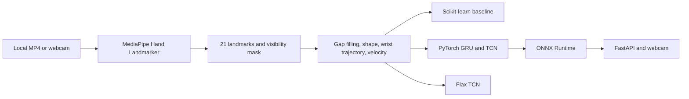

# Hand Gesture Keypoints

Classify eight gestures from 21 MediaPipe hand landmarks per frame. Train a scikit-learn baseline, a PyTorch GRU or temporal CNN, and a Flax temporal CNN on the same subject-wise splits. Serve an ONNX checkpoint with FastAPI or use it in a local webcam demo.

[](https://github.com/jatinmallarapu/hand-gesture-keypoints/actions/workflows/ci.yml) [MIT license](LICENSE)

| Evaluation | Evidence |
| --- | --- |
| Synthetic landmarks | Reproduce all three generated subject folds with `make smoke` |
| Consented webcam clips | Pending acquisition and unseen-participant evaluation |

The synthetic fixture checks the pipeline with generated motion and shape patterns. It does not measure accuracy on people or test MediaPipe tracking.



## Quickstart

Use Python 3.11 or 3.12. The first path needs no camera or model download.

```bash
python -m pip install '.[dev]'
make test
make smoke
```

On Windows without Make, run the commands shown in the Makefile. Use a separate virtual environment for each training backend if dependency resolution requires it.

## Record and extract

Install `.[video]` and download the official Hand Landmarker model, then record clips locally. Use pseudonymous subject IDs with consent. Aim for 40–60 clips per gesture across three or more people, with varied hands, lighting, backgrounds, and distance. Include both empty scenes and random hand movement in `no_gesture`.

```bash
mkdir -p models
curl -L -o models/hand_landmarker.task https://storage.googleapis.com/mediapipe-models/hand_landmarker/hand_landmarker/float16/latest/hand_landmarker.task
python scripts/record_clips.py --subject s01 --gesture swipe_left
make extract
```

Press Space for the countdown and Q to quit. Repeat for `swipe_right`, `swipe_up`, `swipe_down`, `pinch`, `open_palm`, `thumbs_up`, and `no_gesture`. The extraction log records the detection fraction and drop reason per clip. Positive clips below 50% coverage are dropped. Keep empty negatives to preserve the no-hand case. Raw video and extracted participant landmarks stay local. [MediaPipe Hand Landmarker guide](https://ai.google.dev/edge/mediapipe/solutions/vision/hand_landmarker/python)

## Train and evaluate

```bash
make baseline
python -m pip install '.[torch]'
make train-torch
python -m pip install '.[jax,analysis]'
make train-jax
jupyter notebook notebooks/evaluation.ipynb
```

Each fold uses one test participant, the next participant in sorted order for validation, and the remaining people for training. The reports include accuracy, macro F1, per-class results, and confusion matrices. The trainers write per-epoch metrics and keep the validation-best checkpoint. Evaluate abstention and robustness separately from raw classifier accuracy.

- **Shape and motion.** Wrist centering preserves pose. The separate wrist trajectory preserves swipe direction that centering removes. Palm scaling reduces sensitivity to distance from the camera.
- **Augmentation.** Train only with small rotations, scale changes, tracking dropout, time crops, and mirroring. Mirroring swaps the left and right swipe labels.
- **Loss and timing.** Both trainers use smoothed labels, AdamW, and cosine schedules. PyTorch uses weighted cross entropy and Flax applies per-example weights. The Flax model uses LayerNorm, while the PyTorch TCN uses BatchNorm. JAX reports compilation-inclusive first-step time separately from later synchronized steps.
- **Uncertainty.** The shared predictor returns `no_gesture` for missing landmarks or confidence below 0.6. Calibrate the cutoff on validation participants before interpreting it as a reliable reject rule.

## Serve and demo

```bash
make serve CHECKPOINT=runs/torch-tcn/fold-0/best.onnx
make demo CHECKPOINT=runs/torch-tcn/fold-0/best.onnx
```

Use the FastAPI docs at `http://127.0.0.1:8000/docs`. Send 8–300 frames of 21 XYZ coordinates to `/predict/keypoints`, with a JSON null for a missing frame. Video uploads are bounded to 12 MiB and 300 decoded frames. For Docker, mount the exported ONNX file and the MediaPipe asset read-only.

```bash
docker build -t handgest .
docker run --rm -p 127.0.0.1:8000:8000 -v "$PWD/runs:/app/runs:ro" -v "$PWD/models:/app/models:ro" handgest
```

One hand is tracked at a time. The camera demo keeps a 32-frame rolling window and waits for three matching predictions. Real latency, confusion plots, participant results, and a webcam GIF require a recorded experiment.
